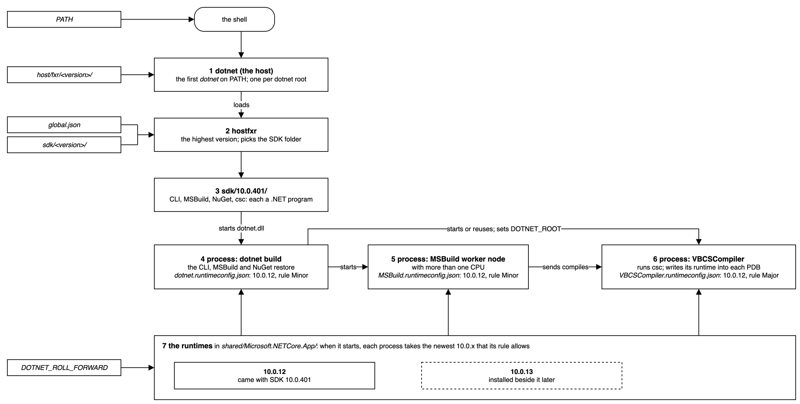
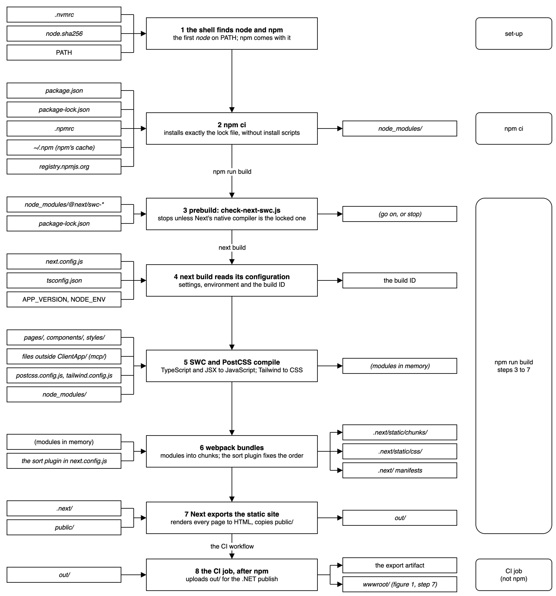
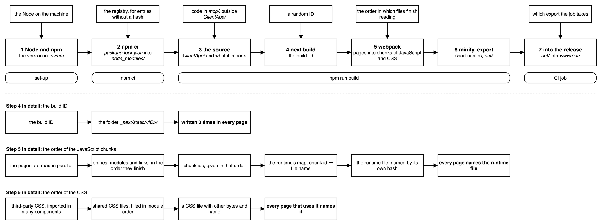

# The figures

The figures are drawn in draw.io. Edit the `.drawio` file and export the
`.drawio.png` at scale 2 (`draw.io -x -f png -s 2 -b 10`). The step numbers in
each figure are the numbers in the tables below.

The finding ids (E, W, R) refer to the [findings table](https://github.com/peterjuulm/Speciale2026/blob/main/notes/findings-table.md) in Speciale2026.
The commits are on the WS.Phoenix branch `thesis/reproducible-builds`.

## Figure 1: build, publish and pack


Steps 1 to 6 are `dotnet build`. `dotnet publish` and `dotnet pack` each run
steps 2 to 6 first, then their own step. Step 8 is not dotnet: it is the
release workflow. Files read are on the left, and files written are on the
right.

### The files in figure 1

| Step | File | Who makes it | Who reads it | What it holds, and what that means | What it changes in the build |
| --- | --- | --- | --- | --- | --- |
| 1 | `global.json` | The developers, in the repository | hostfxr, when `dotnet` starts | An SDK version and a roll-forward rule for the SDK | Which SDK folder runs every later step, and so which MSBuild, NuGet and csc. Figure 2 shows this step |
| 2 | `*.csproj` | The developers | MSBuild | The project's SDK (for example `Microsoft.NET.Sdk.Web`), the target framework, the package references and project properties | What is built, for which framework, with which packages |
| 2 | `Directory.Build.props` | The developers | MSBuild imports it before each `.csproj` in the folders below it | Properties for every project at once | One place for settings that must be the same everywhere, for example path mapping, lock files and the version |
| 2 | The SDK's `.props` and `.targets` | Microsoft, inside `sdk//` | MSBuild | The build rules: default values for every property, and the targets that do steps 3 to 9 | What each step does. Another SDK version can do a step in another way |
| 2 | Environment variables and `-p:` flags | The shell, the CI job, or the person who types the command | MSBuild | Each environment variable becomes a property with the same name. A `-p:` flag sets a property and wins over the project files | A variable whose name is a build property changes the build, and no file in the repository shows it |
| 3 | `packages.lock.json` | NuGet writes it at restore; the developers commit it | NuGet | For one project: every package, direct and transitive, with its exact version and a content hash | In locked mode, restore fails if the graph or a hash is different. Without the file, a version such as `13.0.1` means "13.0.1 or higher", and the graph can change |
| 3 | `NuGet.config` | The machine's user or administrator; a repository can have one too | NuGet | The package sources (feeds), their credentials and the cache folder | Which server the packages come from. WS.PEMS has no `NuGet.config`, so each machine's own file decides |
| 3, 6 | `~/.nuget/packages` | NuGet, when it downloads and unpacks a package | NuGet in step 3; MSBuild in steps 5 to 7 | One folder for each package version, with the package's hash in `.nupkg.metadata` | A package that is already here is not downloaded again. Its files are the ones that the build references and copies |
| 3 | `nuget.org` | Package authors upload; nuget.org adds its signature | NuGet, for each package that is not in the cache | The published `.nupkg` files | The source of every package that the machine does not have yet |
| 3, 4 | `obj/project.assets.json` | NuGet, at the end of step 3 | MSBuild, in steps 4 to 7 | The resolved graph: for each package its version, its hash, and its files for each framework and platform | MSBuild takes the reference DLLs and the files to copy from it. The versions in `deps.json` also come from here |
| 2 | Properties in memory | MSBuild, in step 2 | Every later step | The final value of every property and item after all files are read | Nothing is written to disk. To see the values, use `dotnet build -v:diag` or a binary log |
| 4 | `.git` | git | Source Link, a task in the SDK | The current commit and the remote URL | They go into the PDB's source links and into the informational version. Without `.git`, Source Link knows no source root, so path mapping must be set explicitly |
| 4 | `.editorconfig` | The developers | MSBuild gives it to csc | Code-style and analyzer settings | Which warnings and errors the compiler reports. Source generators can also read settings from it |
| 4, 5 | `obj/*.AssemblyInfo.cs` | MSBuild, in step 4 | csc, in step 5 | C# attributes: version, informational version, company, product | The version strings in the DLL come from this generated file, not from a file in the repository |
| 4, 5 | The csc arguments | MSBuild, in step 4 | csc | Every source file, reference DLL, define and option, for example `/pathmap` and `/deterministic` | The compiler knows only these. A property that does not become an argument does not reach the DLL |
| 5 | `*.cs` | The developers | csc | The source code | The program |
| 5 | The targeting pack | Microsoft; installed with the SDK in `packs/` | csc, as reference DLLs | The .NET API: names and signatures, with no code inside | What the code compiles against. The SDK chooses its version |
| 5, 6 | `obj/X.dll`, `obj/X.pdb` | csc | MSBuild copies them in step 6 | The assembly (IL code and metadata), and its symbols: source paths, compiler version, runtime version | The only files that the build makes from the source. Every other file in the output is copied or generated |
| 6 | The apphost pack | Microsoft; in `packs/` for this machine's platform, from nuget.org for other platforms | MSBuild | A template launcher program | MSBuild copies it and writes the DLL's name into the copy, which becomes `bin/X` |
| 6 | `bin/X.dll`, `X.pdb` | MSBuild, by copying from `obj/` | The host, when the program starts | The same bytes as in `obj/` | The program that runs |
| 6 | `bin/X.deps.json` | MSBuild | hostpolicy, when the program starts | Every library that the program needs, with version, hash and file paths | Which DLL the program loads, and from where |
| 6 | `bin/X.runtimeconfig.json` | MSBuild | hostfxr, when the program starts | The runtime and version to start, the roll-forward rule, and runtime switches | Which runtime the program runs on. Figure 2 shows the same mechanism for the SDK's own programs |
| 6 | `bin/X` (the apphost) | MSBuild | The operating system, when you type `./X` | The launcher with this DLL's name | It finds a .NET root and starts the host, so the program starts without `dotnet` |
| 7 | The runtime pack | Microsoft, on nuget.org | MSBuild, only for `--self-contained` | The whole .NET runtime for one platform: coreclr, the JIT, every `System.*.dll` | It is copied into the release, so the release runs without an installed .NET. The SDK chooses its version |
| 7 | `ClientApp/out/` | The frontend build (`npm ci` and `next build`), a separate CI job | MSBuild | The static website | It is copied into `wwwroot/` and shipped with the backend |
| 7 | `*.json` in the project folder | The developers | The Web SDK | Settings files, such as `appsettings.json` | The Web SDK ships every `.json` file there, also a file that is there by accident |
| 7, 8 | `publish/` | MSBuild, in step 7 | The release job | The complete program for one platform | What is zipped, checksummed and put into images |
| 8 | `*.zip`, `SHA256SUMS`, container images | The release job | Users and operators | The release, and a checksum for each file | What is downloaded and installed, and what a rebuild is compared with |
| 9 | Package fields in `*.csproj` | The developers | NuGet's pack task | Package id, version, authors, licence | They go into the `.nuspec` inside the package |
| 9 | `X.nupkg` | NuGet's pack task | nuget.org, and the restore of other projects | A zip with the DLLs and the `.nuspec` | The package that other projects restore. Signatures are added later, by the author and by nuget.org |

### Problems and fixes in figure 1

| Step | What changed the bytes | What fixed it |
| --- | --- | --- |
| 1 | A loose `global.json` let each machine take its newest SDK. The version number does not identify the compiler binary ([E1-S1-02](../results/findings.md#e1-s1-02)). | `global.json`: 10.0.401 with `rollForward: disable`. CI installs that SDK by hash. (6b7a3254, 332752b9, 7c0089c5) |
| 2 | Settings came from the shell and the machine: the locale, the home folder, the machine's `NuGet.config`. | The build-wide settings are in `Directory.Build.props`. Each one takes effect in a later step. (ed249cd4, 4a6551b4, 84d73a2f, 5031c5af) |
| 3 | Version ranges let the package graph change ([E1-S2-07](../results/findings.md#e1-s2-07)). A restore without the version gave `deps.json` the version 1.0.0 ([E1-S2-09](../results/findings.md#e1-s2-09)). The packs are not in any lock file ([E1-S2-06](../results/findings.md#e1-s2-06)). | Lock files and locked mode in CI ([E1-S2-07](../results/findings.md#e1-s2-07)). One restore, with the version ([E1-S2-09](../results/findings.md#e1-s2-09)). The packs are checked against `nuget-downloads.lock.json` ([E1-S2-06](../results/findings.md#e1-s2-06)). (84d73a2f, 2570034b, 12cb488e) |
| 4 | Without `.git`, only the NuGet cache was mapped, so the build path stayed in the output ([E1-S1-12](../results/findings.md#e1-s1-12)). The release's builds got the version in different ways, so the zips, the images and the migrator had different version fields ([E1-S2-17](../results/findings.md#e1-s2-17)). | `PathMap` anchored to the repository root ([E1-S1-12](../results/findings.md#e1-s1-12)). One `APP_VERSION` for every build ([E1-S2-17](../results/findings.md#e1-s2-17)). (4a6551b4, 5031c5af) |
| 5 | The build path went into the PDB, the DLL's debug directory and generated type names ([E1-S1-09](../results/findings.md#e1-s1-09)–[E1-S1-11](../results/findings.md#e1-s1-11)). The Razor generator wrote absolute paths ([E1-S1-13](../results/findings.md#e1-s1-13)). Roslyn 4.12 sorted generated types by culture ([E1-S2-11](../results/findings.md#e1-s2-11)). The compiler server kept the first build's environment ([E1-M-07](../results/findings.md#e1-m-07)). | `PathMap` ([E1-S1-09](../results/findings.md#e1-s1-09)–[E1-S1-11](../results/findings.md#e1-s1-11)). Unused Razor pages deleted ([E1-S1-13](../results/findings.md#e1-s1-13)). `LC_ALL=C.UTF-8`, not necessary on SDK 10 ([E1-S2-11](../results/findings.md#e1-s2-11)). In the lab: `dotnet build-server shutdown` ([E1-M-07](../results/findings.md#e1-m-07)). (ed249cd4, e6e92423, 4e5237a3) |
| 6 | Two development files hold the absolute path ([E1-S1-14](../results/findings.md#e1-s1-14), [E1-S1-15](../results/findings.md#e1-s1-15)). | No fix is necessary: they are not in the release. |
| 7 | An empty `package-lock.json` was shipped ([E1-S2-03](../results/findings.md#e1-s2-03)). The Linux release got Windows DLLs ([E1-S2-08](../results/findings.md#e1-s2-08)). SDK 10 dated compressed assets with the build time ([E1-S2-18](../results/findings.md#e1-s2-18)). The frontend export had a random build ID and orders from build timing ([E1-S3-01](../results/findings.md#e1-s3-01), [E1-S3-06](../results/findings.md#e1-s3-06), [E1-S3-09](../results/findings.md#e1-s3-09), [E1-S3-10](../results/findings.md#e1-s3-10)). | The file deleted ([E1-S2-03](../results/findings.md#e1-s2-03)). `RuntimeIdentifiers` only on the programs ([E1-S2-08](../results/findings.md#e1-s2-08)). `CompressionEnabled=false` ([E1-S2-18](../results/findings.md#e1-s2-18)). Frontend: the build ID from `APP_VERSION`, CSS in `_app.tsx`, sorted webpack entries and modules. (b0a21823, d0a817c9, e6ce3549, 5031c5af, eed6c240, a16f9a91, 61870435) |
| 8 | `zip -r` stored file times, modes from the umask and disk order ([E1-S4-01](../results/findings.md#e1-s4-01), [E1-S2-13](../results/findings.md#e1-s2-13)). `SHA256SUMS` followed the locale ([E1-S5-07](../results/findings.md#e1-s5-07)). Images recorded the build time and caches ([E1-S6-01](../results/findings.md#e1-s6-01), [E1-S6-02](../results/findings.md#e1-s6-02)). Each signature has its own timestamp ([E1-S5-05](../results/findings.md#e1-s5-05)). | `scripts/pack-release-zip.sh` ([E1-S4-01](../results/findings.md#e1-s4-01)). `LC_ALL=C` ([E1-S5-07](../results/findings.md#e1-s5-07)). `SOURCE_DATE_EPOCH` and `rewrite-timestamp` ([E1-S6-01](../results/findings.md#e1-s6-01), [E1-S6-02](../results/findings.md#e1-s6-02)). A rebuild is compared after the release's signatures are copied onto it ([E1-S5-05](../results/findings.md#e1-s5-05)). (5ec085ac, 97038d73, fa60ea97, 3c337593, 66bf8458) |
| 9 | WS.PEMS does not pack. Experiment 2 found that older SDKs give `.psmdcp` a random name. | No WS.PEMS change. |

### The options in the release commands

`dotnet publish ./src/WebAPI/WebAPI.csproj -c Release -o <folder> -r linux-x64 --self-contained true --no-restore /p:SkipSpaBuild=true`

`publish` is the command. `-c` is an option, and `Release` is its value. Each
option sets an MSBuild property, as `-p:Name=Value` does.

| Option | Property | What it changes |
| --- | --- | --- |
| `-c Release` | `Configuration=Release` | `Optimize=true`, the define `RELEASE`, output in `bin/Release/`. The default is `Debug` for `build`, `run` and `test`, and `Release` for `publish` |
| `-o <folder>` | `PublishDir` | Where the output goes. Not the bytes |
| `-r linux-x64` | `RuntimeIdentifier` | The platform: native files, apphost, runtime pack |
| `--self-contained true` | `SelfContained=true` | The runtime pack is copied into the output (step 7) |
| `--no-restore` | — | Skips step 3; uses the restore that ran before |
| `/p:SkipSpaBuild=true` | WS.PEMS's own | No `npm ci` and `next build`; the frontend job's export is copied in |

Debug is for working with the debugger: no optimization, so breakpoints and
variables behave as in the source. Release is what ships, so CI tests it too.
Debug and Release give different IL, and the PDB records which one was used.

### `.git`, Source Link and deterministic source paths (step 4)

- **`.git`** is the folder where git keeps the repository: every commit, the
  current commit (`HEAD`) and the remote URL. In the build it is only an
  input; it is not compiled and does not ship.
- **Source Link** is a set of MSBuild tasks in the SDK
  (`Microsoft.SourceLink.*`, `Microsoft.Build.Tasks.Git`). It reads `.git`
  without the `git` program, and finds the repository root, the commit and
  the URL. It writes a map from each source file to its URL at that commit
  into the PDB, adds the commit to `InformationalVersion`
  (`v1.0.54+<commit>`), and puts the URL and commit into a package's
  `.nuspec`.

```
.git ──► Source Link ──► SourceRoot: the repository root (and commit, URL)
                                   │
ContinuousIntegrationBuild=true ───┤  sets DeterministicSourcePaths=true
                                   ▼
                     each SourceRoot is mapped to /_/, /_1/, …  ──►  csc /pathmap (step 5)
```

Source Link does not set `ContinuousIntegrationBuild`. The developers set it,
usually only on the CI server, so that a local build keeps its real paths for
the debugger. The property turns on `DeterministicSourcePaths`, which maps
every known source root to `/_/`. The SDK learns the roots from Source Link
(the repository, through `.git`) and from NuGet (the package cache).

Without `.git`, as in our lab's `git archive` export, Source Link finds no
repository root, so only the NuGet cache was mapped and the build path stayed
in the PDBs and DLLs ([E1-S1-12](../results/findings.md#e1-s1-12)). The thesis branch therefore also sets
`PathMap=$(MSBuildThisFileDirectory)=/_/` in `Directory.Build.props`, anchored
to the repository root, which works with or without `.git`. Inside a git
repository, Source Link adds `HEAD` to `InformationalVersion`, so every commit
changes the hash; that is why the lab never builds inside one.

## Figure 2: the SDK's processes and their runtimes



One `dotnet build`. Steps 1 to 3 choose the dotnet root and the SDK. Steps 4
to 6 are three separate .NET processes. In step 7, each process chooses its
own runtime when it starts. The dashed box is a runtime that was installed
later, as it was on the GitHub runners.

### The files in figure 2

| Step | File | Who makes it | Who reads it | What it holds, and what that means | What it changes in the build |
| --- | --- | --- | --- | --- | --- |
| 1 | `PATH` | The shell profile, the installer, or the CI job | The shell | A list of folders. The shell runs the first `dotnet` that it finds in them | Which dotnet root the build uses. On Peter's Mac, `PATH` finds `/usr/local/share/dotnet` (only SDK 9.0.102) before `~/.dotnet` |
| 1 | `dotnet` (the host) | Each SDK or runtime installer; there is one in each root | The shell starts it | A small native program | It looks only in its own folder, the dotnet root, for everything that follows |
| 1, 2 | `host/fxr//` | Each SDK or runtime installer adds a version | The host | hostfxr, the library that chooses an SDK and runtimes | The host always loads the highest version, also one that a later runtime install brought |
| 2 | `global.json` | The developers | hostfxr. It looks in the current folder and in each parent folder | The SDK version, and the rule for when that version is not installed | Which folder in `sdk/` runs. With `rollForward: disable`, a missing SDK is an error. Nothing downloads it |
| 2, 3 | `sdk//` | Each SDK installer adds one folder | hostfxr chooses one | The CLI, MSBuild, NuGet, Roslyn and the build rules. Each program has its own `runtimeconfig.json` and `deps.json` | The tools for every step in figure 1 |
| 4–6 | Each tool's `*.runtimeconfig.json` | Microsoft, inside the SDK folder | hostfxr, each time one of the tools starts | The runtime version the tool asks for (10.0.12) and its roll-forward rule. Minor and Major both take the newest installed 10.0.x patch | Which runtime each process gets. The rule allows a newer patch, so the answer depends on what is installed |
| 4–6 | Each tool's `*.deps.json` | Microsoft, inside the SDK folder | hostpolicy, when the tool starts | The tool's own DLLs, in the SDK folder | It fixes the tool's own libraries. Only the runtime under the tool is chosen at start |
| 6 | `DOTNET_ROOT` | The CLI sets it for the processes it starts. The shell or the CI job can also set it | Launchers such as `VBCSCompiler` and `bin/X` | The dotnet root to use | Which root's runtimes a launcher uses. It does not change any `runtimeconfig.json` rule |
| 7 | `shared/Microsoft.NETCore.App//` | Each SDK or runtime installer adds a version. Nothing removes old ones | hostfxr chooses one; hostpolicy loads it | A complete runtime: coreclr, the JIT, every `System.*.dll` | The runtime that runs MSBuild and the compiler. csc writes its version into every PDB |
| 7 | `DOTNET_ROLL_FORWARD` | Not set by default. The shell or the CI job can set it | hostfxr, at the start of every .NET program | A roll-forward rule | It replaces the rule in every `runtimeconfig.json`, for every .NET program in that shell |

### Problems and fixes in figure 2

| Step | What can change the runtime | What fixed it |
| --- | --- | --- |
| 1 | Two dotnet roots on one machine. `PATH` decides which one runs. | CI: the setup action puts its own SDK folder first on `PATH` and sets `DOTNET_ROOT` to it. In the lab: the full path to `dotnet`. (62ac787a) |
| 2 | A runtime installed later brings a newer hostfxr. Without an exact pin, hostfxr takes the newest SDK. | `global.json` with `rollForward: disable`. One SDK in its own folder has only its own hostfxr. (6b7a3254, 332752b9) |
| 3 | Nothing. The pinned folder holds exactly the tools of 10.0.401. | — |
| 4–6 | Each process chooses its runtime again in step 7. Processes 5 and 6 can stay alive from an earlier build, with that build's environment ([E1-M-07](../results/findings.md#e1-m-07)). | In the lab: `dotnet build-server shutdown` and `MSBUILDDISABLENODEREUSE=1`, so each build starts its own processes. |
| 7 | On GitHub, `actions/setup-dotnet` installed the newest LTS runtime, 10.0.13, beside SDK 10.0.401, which brings 10.0.12. Every process took 10.0.13. csc wrote 10.0.13 into each PDB, so CI's assemblies differed from local builds ([E1-S2-19](../results/findings.md#e1-s2-19)). | `scripts/install-dotnet-sdk.py`: the `global.json` SDK, alone, in an empty folder, checked by hash; it also checks that the folder holds only the SDK's own runtime. Then 10.0.12 is the only runtime the rule can choose. (62ac787a, 7c0089c5) |


### Why one SDK alone is enough

Each tool asks for 10.0.12 and takes the newest installed 10.0.x patch. If the root holds only the SDK and the runtime that came with it, the newest 10.0.x is 10.0.12, so the choice cannot drift. The condition is "one SDK and no other runtime in the root", not only "one SDK". On GitHub, the drift came from an extra runtime, not from an extra SDK. A second SDK of a later patch would do the same, because SDK 10.0.402 brings runtime 10.0.13.

The build must also use that root: `PATH` must find it first, and `DOTNET_ROOT` must name it. The setup action does both.

### A second lock: `DOTNET_ROLL_FORWARD=Disable`

This variable replaces the rule in every `runtimeconfig.json`. With `Disable`, each tool runs on exactly the version it asks for, 10.0.12, or it does not start. On Peter's Mac, we made a copy of the dotnet root with an extra runtime folder named 10.0.13. A test build without the variable ran the CLI and the compiler server on 10.0.13. With `DOTNET_ROLL_FORWARD=Disable`, both ran on 10.0.12. The build succeeded both times (host trace and `lsof`, 3 November 2026).

We do not use it as the fix. It acts on every .NET program in the shell, not only on the SDK. A program that asks for a version that is not installed exactly does not start. The test app asks for 10.0.0, and it failed with `Disable`. Test hosts and `dotnet` tools can fail in the same way. Microsoft recommends `Disable` only for testing.

## Figure 3: the frontend build (npm)



The frontend in `src/WebAPI/ClientApp/` is built by its own CI job. `npm ci`
installs the packages (step 2). `npm run build` runs the `prebuild` script
(step 3) and then `next build` (steps 4 to 7). The CI job hands the export to
the .NET publish, which copies it into `wwwroot/` (figure 1, step 7).

### The files in figure 3

| Step | File | Who makes it | Who reads it | What it holds, and what that means | What it changes in the build |
| --- | --- | --- | --- | --- | --- |
| 1 | `.nvmrc` | The developers | The install-node action in CI; nvm on a developer's machine | One Node version | Which Node runs npm and Next in every later step |
| 1 | `node.sha256` | The developers, from nodejs.org's checksum list | The install-node action | The SHA-256 of the Node archive for each platform | CI installs that exact archive, or fails |
| 1 | `PATH` | The shell profile or the CI job | The shell | A list of folders | Which `node` and `npm` run. The action puts its own Node first |
| 2 | `package.json` | The developers | npm | The direct dependencies with version ranges, and the scripts (`build`, `prebuild`) | What `npm run build` runs. The ranges are used only when the lock file is made |
| 2 | `package-lock.json` | npm writes it at `npm install`; the developers commit it | `npm ci` | Every package, direct and transitive, with exact version, download URL (`resolved`) and hash (`integrity`) | `npm ci` installs exactly this, or fails if it does not match `package.json`. An entry without `integrity` is pinned by version, not by content |
| 2 | `.npmrc` | The developers | npm | npm settings for this folder (two lines) | They apply to every npm command in `ClientApp/` |
| 2 | `~/.npm` | npm | npm | Downloaded package archives, stored by hash | A package already here is not downloaded again. CI keeps the cache under the lock file's hash |
| 2 | `registry.npmjs.org` | Package authors publish there | npm, for each package not in the cache | The published packages | The source of every package the machine does not have yet |
| 2, 5 | `node_modules/` | `npm ci`, which deletes the old folder first | Next, SWC, webpack and the check in step 3 | The installed packages | Every tool and library that the build runs or bundles comes from here |
| 3 | `node_modules/@next/swc-*` | npm, as an optional package for this platform | `check-next-swc.js`, then Next | Next's native compiler for this machine | If it is missing, Next downloads another one without a hash check, or uses a WebAssembly build |
| 4 | `next.config.js` | The developers | Next | The settings: `output: "export"`, `generateBuildId`, and the webpack hook with the sort plugin | How Next builds and exports the site |
| 4 | `tsconfig.json` | The developers | Next and SWC | TypeScript settings and the `@` path alias | How imports are found and compiled |
| 4 | `APP_VERSION`, `NODE_ENV` | The CI job sets `APP_VERSION` (the release tag); Next sets `NODE_ENV=production` | `next.config.js` and Next | The version, and the build mode | The build ID, and production settings in the libraries |
| 4 | The build ID | Next, from `generateBuildId` | Next, in steps 6 and 7 | One string | It names `_next/static/<id>/` and is written into every page |
| 5 | `pages/`, `components/`, `styles/` | The developers | SWC and PostCSS | The source code and the styles | The site |
| 5 | Files outside `ClientApp/` (`mcp/`) | The developers of the MCP servers | SWC, through imports | Shared TypeScript code | The frontend needs files outside its own folder, so the build needs the whole repository |
| 5 | `postcss.config.js`, `tailwind.config.js` | The developers | PostCSS and Tailwind | The CSS steps, and the files Tailwind scans for class names | Which CSS is generated |
| 5, 6 | Modules in memory | SWC and PostCSS | webpack | One compiled module for each source file | webpack's input. Nothing is written to disk |
| 6 | The sort plugin in `next.config.js` | The thesis branch | webpack | Code that sorts the entries, the modules and the links by name before chunks are made | Chunk ids and file contents no longer depend on build timing |
| 6 | `.next/static/chunks/`, `.next/static/css/` | webpack | Next, in step 7 | The JavaScript and CSS bundles, with a content hash in each name | They are copied to `out/_next/static/` |
| 6 | `.next/` manifests | Next | Next, in step 7 | Which chunks and CSS files each page needs | Next writes the `<script>` and `<link>` tags in each page from them |
| 7 | `.next/` | Steps 4 to 6 | Next's export | The whole build | The source of the export |
| 7 | `public/` | The developers | Next | Static files: images, icons, fonts | Copied into `out/` as they are |
| 7, 8 | `out/` | Next | The CI job | The static site: HTML, JavaScript, CSS | What the release ships in `wwwroot/` |
| 8 | The export artifact | The CI job | The publish jobs | `out/` as a CI artifact | The Linux and the Windows release use the same export |
| 8 | `wwwroot/` | MSBuild, in figure 1 step 7 | The WebAPI, when it runs | The frontend inside the release | What users load in the browser |

### Problems and fixes in figure 3

| Step | What changed the bytes, or could | What fixed it |
| --- | --- | --- |
| 1 | CI asked for "20.x", so the newest Node 20 of the day ran. The Dockerfile used another Node (23). `setup-node` checked no hash | `.nvmrc` and `node.sha256`; the install-node action installs that Node from nodejs.org, checked by hash (`63129480`, `456504fa`) |
| 2 | 391 lock entries had no `resolved` and no `integrity`, so npm asked the registry for them ([E1-S3-05](../results/findings.md#e1-s3-05)). Install scripts printed banners, set up git hooks, or downloaded a native binary without a hash | The missing fields filled in, twice (`e19ca414`, `bc0c52f6`). `npm ci --ignore-scripts` (`456504fa`) |
| 3 | Without its native compiler, Next downloads one without a hash, or uses another compiler | `check-next-swc.js` stops the build (`456504fa`) |
| 4 | Next drew a random build ID for every build ([E1-S3-01](../results/findings.md#e1-s3-01)) | `generateBuildId` returns `APP_VERSION`, or `dev` (`5031c5af`, [E1-S2-17](../results/findings.md#e1-s2-17)) |
| 5 | The frontend imports code from outside `ClientApp/` ([E1-S3-03](../results/findings.md#e1-s3-03)) | No code change. A rebuild uses the whole commit, not only `ClientApp/` |
| 6 | Webpack took the order of entries ([E1-S3-09](../results/findings.md#e1-s3-09)), modules and links ([E1-S3-10](../results/findings.md#e1-s3-10)) from build timing. Shared CSS files took the order of third-party stylesheets from build timing ([E1-S3-06](../results/findings.md#e1-s3-06)) | The sort plugin in `next.config.js` (`a16f9a91`, `61870435`, `acbea21c`). All third-party CSS imported in `_app.tsx` (`eed6c240`, `a16eb506`) |
| 7 | After the fixes, two exports of one commit are the same | — |
| 8 | The Windows release built an export of its own | The Windows job takes the release's own export (`019c7b49`) |

## Figure 4: what the frontend findings are about



A short version of figure 3 that keeps only what the findings need. The top
row is the build, with the input that can vary above each step. The three
chains below show why a small change is so visible: the build ID, the order of
the JavaScript chunks and the order of the CSS each end in a name that every
page contains. So one moved entry changes all 108 pages.

### The frontend findings, by step

| Step | What varied | Finding | Fix | Status |
| --- | --- | --- | --- | --- |
| 1 | CI asked for Node `20.x`, so the newest Node 20 of the day ran; the Node of an old release cannot be read back | [E1-S3-04](../results/findings.md#e1-s3-04) | `.nvmrc` with one exact version, installed from nodejs.org by hash (`63129480`, `456504fa`) | Fixed |
| 2 | 391 lock entries had no `resolved` and no `integrity`, so the registry decided where each package came from | [E1-S3-05](../results/findings.md#e1-s3-05) | The two fields filled in (`e19ca414`, `bc0c52f6`) | Fixed |
| 2 | npm 10 drops the `libc` field when it rewrites the lock; npm 11 keeps it. This matters only when the lock is written again, not for `npm ci` | [E1-S3-08](../results/findings.md#e1-s3-08) | — | Open |
| 3 | The build reads 7 files outside `ClientApp/`: 4 in `mcp/` and 3 in `src/WebAPI/utilities/api` | [E1-S3-03](../results/findings.md#e1-s3-03) | A rebuild uses the whole commit, not only `ClientApp/` | Fixed |
| 4 | Next drew a random build ID for every build | [E1-S3-01](../results/findings.md#e1-s3-01) | `generateBuildId` returns `APP_VERSION`, the release tag, or `dev` (`5031c5af`, [E1-S2-17](../results/findings.md#e1-s2-17)) | Fixed |
| 5 | Webpack gave chunk ids in the order the entries finished reading; one entry in another place gave another runtime file, and all 108 pages changed | [E1-S3-09](../results/findings.md#e1-s3-09) | The entries sorted by name before chunks are made (`a16f9a91`) | Fixed |
| 5 | After that sort, the order of the modules and of their links still came from timing | [E1-S3-10](../results/findings.md#e1-s3-10) | The same plugin sorts modules and links too (`61870435`, `acbea21c`) | Fixed |
| 5 | Third-party stylesheets went into shared CSS files in module order, which followed timing | [E1-S3-06](../results/findings.md#e1-s3-06) | All third-party CSS imported once, in `_app.tsx` (`eed6c240`, `a16eb506`) | Fixed |
| 6 | The minifier's short variable names differed between two commits, not within one; the cause is not known | [E1-S3-07](../results/findings.md#e1-s3-07) | — | Open |
| 7 | Stage 2 was first measured without the export in `wwwroot/` | [E1-M-11](../results/findings.md#e1-m-11) | Measured again with the export in place | Fixed |
| 7 | On a self-hosted runner, the Windows job took an export that another job had left there | [E1-S5-08](../results/findings.md#e1-s5-08) | The Windows job always downloads the release's own export (`019c7b49`) | Fixed |

Two findings hold for the whole figure. [E1-S3-02](../results/findings.md#e1-s3-02) is the baseline: two clean builds
at the same path were identical except for the build ID. [E1-S2-20](../results/findings.md#e1-s2-20): a build on
macOS arm64 gave the same 994 files of the export as GitHub's Linux runner.
