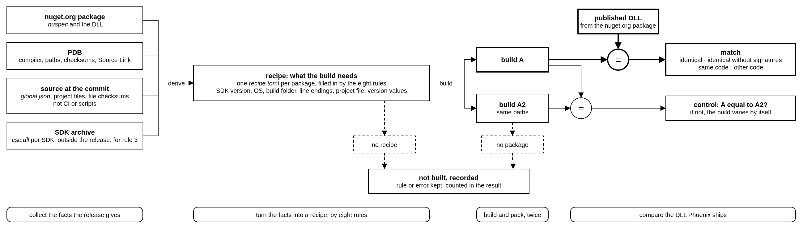
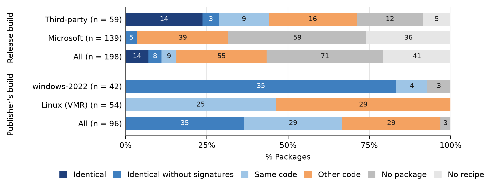

# Rebuilding published NuGet packages

Given a package on nuget.org and the commit it names, can a third party
reproduce the DLL served by nuget.org using only the release and the source at
that commit? If not, what is missing?

Part 2a compares two of our own builds. Part 2b compares our build with the
publisher's bytes. Benedetti et al. (2025) deliberately omit this comparison
because the commit behind an upload is difficult to identify. For packages that
provide these records, the `.nuspec` identifies a commit and Source Link maps
source files to it. These records give us a starting point for the comparison.

## Method



A recipe is derived from the release, built twice as A and A2, and A's DLL is
compared with nuget.org's and with A2's. The match box, drawn with the heavier
frame, is the result; the A-to-A2 control only checks the build.

### Population

We start with the 341 packages shipped by Phoenix
(`../population/results/shipped-packages.txt`), classified in the population
(`../population/README.md`).

Part 2b includes packages that ship managed code and whose release identifies
both a commit and, through the PDB, the compiler. Of the 341 packages, 38 ship
no managed code. Another 105 of the remaining 303 fail the filter:

- 9 name no repository.
- 13 name no commit.
- 45 have no PDB.
- 36 have a PDB that is neither in the package nor available from a symbol
  server.
- 2 have a PDB without a compiler record.

This leaves **198 packages**: 59 third-party and 139 Microsoft packages.
`population.tsv` records the package, version, DLL shipped in Phoenix, owner and
class from the population.

This differs from the 224 packages in part 2a
(`../2a-determinism/population.tsv`). The populations share 185 packages. Part
2a includes 39 packages absent here. Part 2b includes 13 absent from part 2a.

The filters explain the difference. Part 2b derives the SDK from the PDB
compiler record, so a package without that record cannot receive a recipe. Part
2a fixes one SDK and requires only a repository, commit and project.

### Deriving a build recipe

`scripts/derive.py` derives each package's build parameters from its release
using eight rules. The `facts.txt` file beside each recipe marks every value as
*read*, *inferred* or *default*. Read values name their source. Inferred values
name the rule that turned an observation into a choice. Defaults state why they
were used.

| rule | value | taken from |
|---|---|---|
| 1 | package, PDB | nuget.org: the `.nupkg`, else the `.snupkg`, else the symbol server by the DLL's CodeView key |
| 2 | source | the `.nuspec`'s commit; the clone URL from the PDB's Source Link entry at that commit |
| 3 | SDK | `global.json` if its SDK's `csc.dll` has the PDB's compiler version; else the lowest public SDK of the channel whose `csc.dll` has it (inferred; the SDKs not read are listed) |
| 4 | OS | Windows if the SDK-generated files embedded in the PDB have CRLF, else Linux (inferred) |
| 5 | build folder | the PDB's document paths, when they are absolute |
| 6 | checkout line endings | as stored or converted to CRLF, whichever gives the PDB's source checksums |
| 7 | project | the `.csproj` whose assembly name is the DLL's; `ref/` projects dropped; of several, the one named like the package |
| 8 | version | `VersionPrefix`/`VersionSuffix` from the informational version, `AssemblyVersion` and `FileVersion` from the DLL, `PackageVersion` from the `.nuspec` |

If the rules cannot resolve a package, it receives *no recipe* and the rule that
stopped the derivation.

Every package uses the same command:

```bash
dotnet build PROJECT -c Release <properties> && dotnet pack PROJECT -c Release --no-build -o out-nupkg <properties>
```

`<properties>` contains the values from rule 8, with
`ContinuousIntegrationBuild=true` when PDB paths are mapped to `/_/`. The method
does not read CI files or build scripts. It uses only information available to a
consumer from the release.

### Controlled build environment

We install each derived SDK alone from Microsoft's archive after checking its
SHA-512 hash (`../tools/install-sdk.py`). Each build starts from a fresh full
clone at the named commit and an empty package cache. `NuGetAudit=false`
prevents advisories published after the release from failing the restore.

On Linux, the environment is empty except for `HOME`, `PATH`, `LANG` and
`NUGET_PACKAGES`. Linux recipes run on `arch` (Arch Linux, kernel 7.2.11), or on
GitHub's `ubuntu-24.04` runner when the PDB records a runner build folder.
Windows recipes run on GitHub's `windows-2022` runner (image 20261022.344.1).

Each package is built twice in the same paths, A and A2. All generated state is
deleted between builds.

### Comparison and matching

The comparison uses the DLL shipped in Phoenix, extracted both from our rebuilt
package and from the package on nuget.org. This is the file `population.tsv`
names for the package. It narrows part 2a's level 3, the assemblies, from
all DLLs to the single DLL loaded by Phoenix.

`../tools/dllreport.cs` reads both DLLs and hashes each section, metadata stream
and resource separately. `scripts/level.py` then decides how well the pair
matches:

| match | what differs |
|---|---|
| identical | nothing |
| identical without signatures | only the Authenticode block, the strong-name signature and the PE checksum (`../tools/stripsign.cs` cuts them and hashes the rest) |
| same code | only the build identity: MVID, PE timestamp, PDB id and checksum |
| other code | anything in IL, the metadata streams or the resources |

Part 2a's level 1, the package file, cannot be applied to nuget.org packages.
After upload, nuget.org adds its repository signature, `.signature.p7s`. A
rebuilt package therefore cannot be byte-for-byte identical to the served
package.

Levels 2 and 3 can still be determined from the stored package listings
(`results/compare.txt`). Of the 86 packages built and compared, 9 are equal at
level 2, the package entries without NuGet's packaging files and repository
signature. Eleven are equal at level 3, the assemblies, every DLL under `lib/`,
`ref/` and `runtimes/`. Every signed package fails both levels because of the
signature alone. Part 2b therefore matches the single DLL.

We group packages by result:

- *Reproduced*: identical, or identical without signatures.
- *Built, but differs*: same code, or other code.
- *Not built*: no package, or no recipe.

A publisher's signing key is required to reproduce a signature. For a signed
package, identical without signatures is therefore the highest attainable match.

The A-to-A2 comparison is a control. It separates a build that differs from the
publisher from one that also differs from itself.

## Running the experiment

Run from `2-dependencies/2b-rebuild/` on Linux, with Python 3.11 or later, git,
and network access to nuget.org, GitHub and Microsoft's SDK archives.

1. One SDK, installed alone. The DLL reports require a .NET 10 SDK. Each build
   installs its own SDK later.

```bash
LAB=$HOME/rebuild-lab                        # outside any repository
python3 -I ../tools/install-sdk.py 10.0.403 $LAB/report-sdk
```

2. Everything this machine can build, from `population.tsv` to `results/`. This
   derives every package, builds the Linux recipes here, and compares every
   build with nuget.org. The rows go into `results/release-build.tsv` and
   `results/compare.txt`, replacing stored rows for the same packages.

```bash
python3 -I scripts/run-batch.py population.tsv $LAB
```

3. The tables.

```bash
python3 -I scripts/summary.py                # results/summary.md, results/categories.tsv
```

### Recipes that need Windows

Most recipes name Windows as the publisher's host. Two more need GitHub's Ubuntu
runner because their PDBs record the build folder `/home/runner/work/...`, which
cannot be made here. Step 2 lists them in `$LAB/runner.txt`. On a Windows
machine with Python and git, build each one with:

```bash
python -I scripts/rebuild.py RECIPE WORKDIR
```

To use GitHub's runners, copy `scripts/nupkg-rebuild.yml` to
`.github/workflows/` in a fork, commit the recipes, and start one run per
recipe. Each artifact is the build's `out` folder:

```bash
gh run download RUN -D $LAB/runner/<Package>-<version>
```

Put each `WORKDIR/out` or artifact under `$LAB/runner/<Package>-<version>/`,
then run steps 2 and 3 again. Step 2 reuses existing builds.

### The publisher's build

The publisher's build runs after step 2 in the same lab. It derives recipes from
`publisher-build/packages.txt` and builds the four dotnet/dotnet recipes here.
They require clang, cmake and ninja.

```bash
python3 -I publisher-build/scripts/run-repo-batch.py $LAB
```

The other recipes are listed in `$LAB/repo-runner.txt`. Run them on Windows in
the same way, with `publisher-build/scripts/repo-build.py` or
`publisher-build/scripts/nupkg-repository-build.yml`. Put their output under
`$LAB/repo-runner/<name>/`. A second run classifies them into
`$LAB/publisher-build.tsv`, in the form of
`publisher-build/results/publisher-build.tsv`.

## Results

The run took place on 27 October 2026. The third-party packages ran from 13:05
to 13:55, and the Microsoft packages from 10:50 to 12:38.

The experiment derived 157 recipes: 137 ran on `windows-2022`, 18 on `arch` and
2 on `ubuntu-24.04`. `scripts/summary.py` writes the tables to
`results/summary.md`.

### Release build

The release build covers all 198 packages.

| group | match or outcome | third-party | Microsoft | all |
|---|---|---|---|---|
| reproduced (22) | identical | 14 | 0 | 14 |
| | identical without signatures | 3 | 5 | 8 |
| built, but differs (64) | same code | 9 | 0 | 9 |
| | other code | 16 | 39 | 55 |
| not built (112) | no package | 12 | 59 | 71 |
| | no recipe | 5 | 36 | 41 |
| | total | 59 | 139 | 198 |



The matches of the release build above, and of the publisher's build below (see
Using the publisher's build system).

The release-derived build reproduces 22 of the 198 packages: 17 of 59
third-party packages and 5 of 139 Microsoft packages. More than half do not
build.

A equals A2 for 76 of the 86 compared packages. Nine packages differ from
themselves: the IdentityModel packages, whose version includes the clock. One
further package was not compared. This reproduces part 2a's finding without
adding variation.

The following assemblies are byte-for-byte identical: RBush; FluentValidation
and its DependencyInjectionExtensions; Serilog; Serilog.Sinks.File;
Serilog.Sinks.Seq; Ardalis.GuardClauses; CsvHelper; Markdig; Npgsql and its EF
Core provider; ScottPlot; TimeZoneConverter; and UnitsNet.

Cronos, Hangfire.InMemory, NodaTime, Microsoft.Identity.Abstractions,
Microsoft.Identity.Web.Certificateless, .Diagnostics, .TokenCache and
Microsoft.OpenApi matched as *identical without signatures*. These eight
cases were assessed from DLL reports. The complete signature-stripped files were
not hashed.

### Builds with other code

Fifty-five packages produce other code. One value written into the assembly by
the publisher's build accounts for most of these differences. The release states
this value, but the project does not accept it as an input.

| cause | packages | what differs |
|---|---|---|
| Arcade's development versioning | 17 (Roslyn 7, EF Core 7, Sqlite, DiaSymReader, Build.Framework) | `FileVersion` 42.42.42.42424 instead of the shipped one; the informational version loses `+<commit>` |
| clock in the version | 9 (IdentityModel) | `8.23.0-preview-<clock>`; these are the nine where A differs from A2 |
| date suffix on unofficial builds | 8 (Azure SDK, System.ClientModel) | `1.50.0-alpha.<date>.1` against `1.50.0` |
| copyright year from the build clock | 6 (Swashbuckle 5, Stateless) | 2024 against 2026 |
| attributes written by the CI script | 3 (Bogus, YamlDotNet, FluentModbus) | `GenerateAssemblyInfo=false`; the values come from a script the method does not run |
| version computed from git | 2 (MediatR.Contracts by MinVer, ExCSS by GitVersion) | MinVer's tag height; the branch name in the informational version |
| targeting pack | 2 (SharpZipLib, MediatR.Extensions.Microsoft.DependencyInjection) | `TargetFrameworkAttribute`'s display name; IL differs too |
| `RepositoryUrl` form | 2 (Serilog.Settings.Configuration, Serilog.Extensions.Logging) | with or without `.git` |
| signing key | 1 (RecyclableMemoryStream) | strong name and `InternalsVisibleTo` with a key outside the repository |
| not read | 5 (Google.Protobuf, ShimSkiaSharp, Identity.Web 3) | |

### Builds with the same code

Nine third-party packages produce the same code: Ardalis.Specification 2,
AutoMapper, MediatR, Quartz 4 and SendGrid. Their IL, metadata and resources are
equal. Only the build identity differs.

Under deterministic compilation, the build identity is a hash that also covers
the PDB, which this match does not compare. These differences were not
investigated further.

### Packages not built

A total of 112 packages were not built.

| outcome | cause | packages |
|---|---|---|
| no recipe | the compiler is in no public SDK (Microsoft's 8.0.0 and 9.0.0 GA packages and others) | 25 |
| | the compiler ran on .NET Framework (Visual Studio's MSBuild) | 10 |
| | the commit is not reachable at the repository (IdentityModel 8.19.2) | 2 |
| | no single project with the assembly name | 2 |
| | no PDB with a compiler record (SqlClient) | 1 |
| | the checkout failed (ImageSharp) | 1 |
| no package | a project in `dotnet/dotnet` or `dotnet/runtime` needs the repository's bootstrap | 37 |
| | another single-project build error (Svg 5, Identity.Web and others 7) | 12 |
| | SDK workloads (SkiaSharp, HarfBuzzSharp) | 5 |
| | Microsoft's internal feed in `NuGet.config` (ASP.NET Core 9.0.0) | 4 |
| | a `Directory.Build.props` the repository's script generates (Razor 6.0.24) | 2 |
| | a feed outside nuget.org (SixLabors.Fonts), a restore of RazorGenerator (Hangfire 2) | 3 |
| | packed, but not under the release's id and version (Dapper, Humanizer.Core, Mono.TextTemplating, Portable.BouncyCastle, Workspaces.MSBuild, NETCore.App.Runtime, SolutionPersistence) | 7 |
| | the runner job left no output (dotnet-ef) | 1 |

The causes come from the first error in each build log in the working
repository. `summary.py` does not determine them.

## Using the publisher's build system

Most Microsoft packages fail in the release build for the same reason: the
project expects the repository's Arcade build system to run first. A second
build measures the value of knowing that build system.

This experiment covers the 96 packages from Arcade repositories. It excludes the
two runtime packs, which require a full product build, and StringTools, which
has no project.

The build invokes the repository's own entry point at the named commit:
`eng/build.sh` or `build.cmd` with `--ci -c Release --pack`, the package subset
documented by the repository. It passes the `OfficialBuildId` decoded from the
shipped file version and the release branding used by the official pipeline.

For the inner repositories of `dotnet/dotnet`, it also passes the two identity
properties used by the VMR: `RepositoryUrl` and `RepoOriginalSourceRevisionId`.
The build disables optimization data through `EnableNgenOptimization=false` and
removes Microsoft's internal feeds from `NuGet.config`.

The 16 standalone recipes, covering 42 packages, ran on GitHub's `windows-2022`
runners, matching the publisher's host. The four VMR builds, covering 54
packages, ran on `arch` because `dotnet/dotnet` does not fit on a free runner.

| group | match or outcome | windows-2022 | Linux (VMR) | all |
|---|---|---|---|---|
| reproduced (35) | identical without signatures | 35 | 0 | 35 |
| built, but differs (58) | same code | 4 | 25 | 29 |
| | other code | 0 | 29 | 29 |
| not built (3) | no package | 3 | 0 | 3 |
| | total | 42 | 54 | 96 |

Of the 42 packages built on the publisher's host, 35 are reproduced. Every
compared assembly is byte-for-byte identical after signatures are removed
(`publisher-build/results/signature-stripped.txt`). The same recipes reached
only the same-code match on Linux, and no VMR package is reproduced.

All 25 packages whose compiler is unavailable in a public SDK built in this
experiment. Twenty-two are reproduced, and three reach the same-code match. The
repository's build system supplied the compiler.

For the reproduced assemblies, source access was not enough. The build also
required knowledge of the publisher's pipeline. Additional inputs included build
IDs, versioning rules, the host operating system and build steps outside the
project. The release metadata did not provide a complete recipe for those steps.

The eight Roslyn packages are reproduced only under one rule. Roslyn's official
pipeline does not pass release-branding properties, so the build keeps the
prerelease informational version found in the shipped assemblies. A later repack
changes the package version to 5.0.0.

This rule was added after a Windows run with branding properties produced other
code because of that single string. Applying branding properties to every
repository reproduces 27 of 42 packages instead of 35.

### Results per package

| category | packages | without the Roslyn rule |
|---|---|---|
| from the release | 22 | 22 |
| with the publisher's build | 35 | 27 |
| not reproduced (best match same code 38, other code 68) | 106 | 114 |
| no package | 22 | 22 |
| no recipe | 13 | 13 |

One of the two builds reproduces 57 of the 198 packages. Without the Roslyn
rule, the count is 49. The 13 packages without a recipe are the .NET Framework
compilers, the IdentityModel commits, SqlClient and ImageSharp.

## Earlier versions of the method

The working repository holds three release-build versions and five
publisher-build versions, each documented before its run. Only the last of each
is here. The earlier ones ran a single `dotnet pack` (no package for a
`GeneratePackageOnBuild` project), left out the assembly and file versions,
lacked the VMR identity properties, or checked out files exactly as committed
where the shipped bytes have CRLF endings. The Roslyn rule was added after
inspecting an earlier result. One rule set per build gives the same count as the
working repository's "best of all versions" from 28 October.

## Caveats

- There is no held-out set. The rules were refined using the packages later
  measured. Each version was documented before it ran, and the earlier rows are
  retained. This makes the iteration auditable but not blind. The Roslyn rule is
  the only rule written after observing its result.
- The method injects the version, file version, `OfficialBuildId` and
  `RepositoryUrl` read from the shipped DLL. Matching these attributes alone is
  not evidence. The evidence comes from the IL, metadata and resources.
- The eight release-build rows matched as identical without signatures were
  assessed from report lines, not from hashes of the complete DLL produced
  with `stripsign.cs`. The 35 corresponding publisher-build rows were hashed as
  complete DLLs.
- Rule 3 selects the lowest SDK containing the compiler. Higher SDKs with the
  same compiler are listed but not tested.
- Rule 7 reads `AssemblyName` directly from the `.csproj` text instead of
  evaluating it through MSBuild. Workspaces.MSBuild selected the wrong project.
- Each package is built once against the publisher, with A2 as its repeat. A
  difference is observed. Equality means no difference was detected, as in part
  2a.
- Restore used the feeds available on 27 October 2026, not those available on
  the release date. A dependency that had since been unlisted or moved would
  appear as a failed restore or a difference.
- The publisher's build covers only Arcade repositories. Each third-party
  repository has its own build process, including scripts, Cake, Nuke or CI
  files. No single rule covers them all. The 25 third-party rows that built but
  differed were not retried with those repository-specific systems.
- This is a case study of one product's dependency closure, not a sample.

## Data and scripts

```
2b-rebuild/
  README.md
  population.tsv              the 198 packages, owner, class and the DLL Phoenix ships from each
  figures/
    pipeline-2b.drawio        the method as a pipeline; pipeline-2b.drawio.png is its export
    match.pdf, .png           the matches per group, release and publisher's build, from results/categories.tsv
  scripts/
    derive.py                 the eight rules: release facts to recipe.toml and facts.txt
    rebuild.py                one recipe: SDK by hash, fresh clone, build A and A2, pack
    compare.py                two packages entry by entry
    level.py                  matches one DLL pair from two dllreport.cs reports
    run-batch.py              derive.py and rebuild.py over population.tsv, then results/
    summary.py                prints results/summary.md and categories.tsv
    figures.py                the match figure: python3 -I scripts/figures.py [THESIS_IMAGES]
    sdk-csc.json              SDK version to compiler version; derive.py reads and extends it
    nupkg-rebuild.yml         the GitHub workflow for the runner recipes; not active here
  results/
    release-build.tsv         one row per package, with a source column
    compare.txt               the package listing of every compared build, one section each
    environment.txt           one line per host
    summary.md                printed by summary.py
    categories.tsv            printed by summary.py
  publisher-build/
    packages.txt              the 99 Arcade packages, kept by hand; input to derive-repo.py
    scripts/
      derive-repo.py          publisher recipes per repository and commit; --v5 is the final rule set
      repo-build.py           one publisher recipe; reads rebuild.py and compare.py from scripts/
      run-repo-batch.py       derive-repo.py and repo-build.py over packages.txt
      nupkg-repository-build.yml   the workflow from the Windows run; not active here
    results/
      publisher-build.tsv     one row per package, with a source column
      signature-stripped.txt  complete-DLL hashes for the 35 reproduced packages
```

`../tools/` holds `install-sdk.py`, `dllreport.cs` and `stripsign.cs`, shared
with 2a and unchanged.

`scripts/figures.py` draws `figures/match`, as PDF and PNG, from
`results/categories.tsv`. Given a folder, it also writes the PDF there for the
thesis: `python3 -I scripts/figures.py [THESIS_IMAGES]`. It needs matplotlib.
`figures/pipeline-2b.drawio` is the pipeline in the Method section. Export it
with `drawio -x -f png -e -s 2 -b 10 -o figures/pipeline-2b.drawio.png
figures/pipeline-2b.drawio`.

The scripts are the working repository's with lab paths and unused options
removed. `run-batch.py` replaces its `run-batch.py` and `derive-batch.py`
without the recipe commits, GitHub dispatch and disk guard; runner builds start
by hand from `runner.txt`. In the lab it writes `derive/<Package>-<version>/`,
`build/<Package>-<version>/out/`, `runner.txt`, `results.tsv`, `compare.txt` and
`run.log`, and installs the report SDK if step 1 was skipped. One package by
hand:

```bash
python3 -I scripts/derive.py PACKAGE VERSION population.tsv $LAB $LAB/derive/PACKAGE-VERSION
python3 -I scripts/rebuild.py $LAB/derive/PACKAGE-VERSION/recipe.toml WORKDIR
```

The stored run took under one hour for the 59 third-party packages and two hours
for the 139 Microsoft packages, with the runner builds in parallel. The four
dotnet/dotnet builds took under one hour together on 16 cores; a Windows build
takes 6 to 30 minutes on a 4-core runner, with the Node version the recipe names
first on `PATH`.

The `source` column names the run each row comes from. `release-build.tsv` holds
the two version-3 runs of 27 October, `2026-10-27-nupkg-release-only-batch2-v3`
and `2026-10-27-nupkg-release-only-batch3-microsoft`. `publisher-build.tsv`
holds the Windows run of 28 October
(`2026-10-28-nupkg-repository-build-windows`), the eight Roslyn rows from the
rerun under the Roslyn rule (`…-windows-v5`) and the VMR rows from the Linux run
(`2026-10-28-nupkg-repository-build-v2`); `match_without_roslyn_rule` keeps
Roslyn's match from the first Windows run. The run wrote that column as
`grade_without_roslyn_rule`; only the header was renamed on 3 November.

Checked on 3 November:

- `summary.py` reproduces `results/summary.md` and `results/categories.tsv` from
  the stored files.
- The VMR recipes derived here are byte-for-byte the recipes of the Linux run.
- `run-batch.py` ran on RBush 4.0.0 and FluentValidation 11.11.0 on `arch`. Both
  rows match the stored ones in SDK, match, A equal to A2 and differing lines;
  `runner` says `local` where the stored row says `arch`, the recipes differ
  only in comment lines, and the listings only in NuGet's `_rels/.rels`, which
  gets a new ID on every pack. Run again in an empty lab, it gave the same two
  rows and left the other 196 rows and 84 listings in `results/` unchanged.
- Cronos 0.9.0 was rebuilt on GitHub's `windows-2022` runner (image
  20261026.347.1) through the working repository's workflow, [run
  41599872747](https://github.com/peterjuulm/Speciale2026/actions/runs/41599872747).
  That workflow runs the working repository's `rebuild.py` at `f127442`, which
  runs the same commands as the copy here for this recipe. The row matches the
  stored one in SDK, match, A equal to A2 and differing lines, and the shipped
  `Cronos.dll` is byte-for-byte the DLL of the 27 October run.
- Not run from here: `repo-build.py`, `run-repo-batch.py`, and `stripsign.cs` on
  the eight rows matched as identical without signatures. The copy of
  `rebuild.py` here has not run on Windows.

Every recipe, `facts.txt`, build log and DLL report is in the working
repository, [Speciale2026](https://github.com/peterjuulm/Speciale2026), at
`f127442` under `dependencies/experiments/nupkg/recipes/` and the data folders
named above. The notes of record are
`dependencies/notes/2026-10-26-nupkg-release-only.md` (the rules),
`2026-10-27-nupkg-release-only-batch2-v3.md` and
`2026-10-27-nupkg-release-only-batch3-microsoft.md` (version 3 and its run),
`2026-10-27-nupkg-repository-build-plan.md`,
`2026-10-28-nupkg-repository-build.md`,
`2026-10-28-nupkg-repository-build-windows.md` and
`2026-10-28-framework-synthesis.md`.
