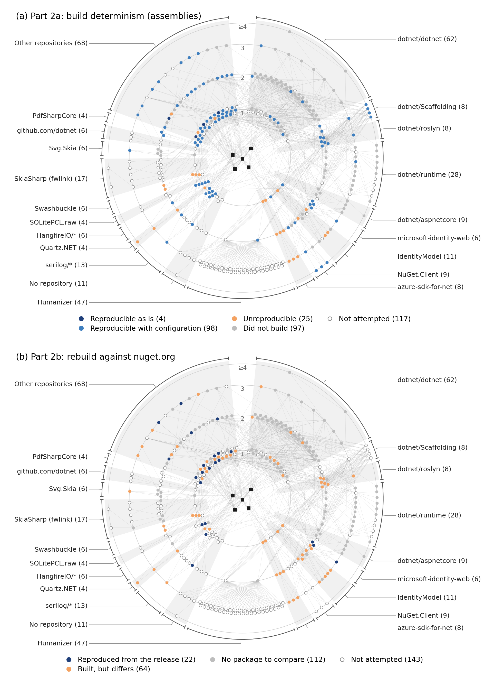

# The dependency graph of Phoenix's packages

The three steps of experiment 2 treat the 341 packages as a list. This folder
draws them as a graph: which package brings in which, how far each one is from
Phoenix's own projects, and where each one comes from. Each node is coloured
by its result in part 2a and in part 2b. The graph is a static figure for the
thesis and a page where each node can be opened.



(a) the categories of part 2a at the assembly level, (b) the categories of
part 2b. One colour means the same kind of result in both: dark blue, reproduced
with the default inputs; mid blue, reproduced with extra inputs, which only 2a's
configuration has; orange, built and compared, but different; grey, not built;
hollow, outside the part's population. The five black squares are Phoenix's programs and projects.

## The graph

The nodes are the 341 package versions of `../population/` and the five
Phoenix projects they hang from: the three programs WebAPI,
BackgroundJobExecutor and DbMigrator, and the two class libraries
ApplicationCore and Infrastructure that the programs reference.

The edges come from the three programs' `packages.lock.json` at Phoenix
`79cb67a7`, sections `net10.0` and `net10.0/linux-x64`. An edge runs from a
project to each package it names, and from a package to each dependency the
lock file resolved for it. Names are matched without regard to case. Each
program's lock file gives one set of edges; the graph is the union of the
three, with 896 edges. The three runtime and host packs are not in any lock
file. They are joined to every program, 9 edges, because the population does
not record which program needs which pack. dotnet-ef has no edge: it is a
tool whose SQL script ships.

Each package sits on a ring and in a sector:

- The ring is the number of steps from the nearest Phoenix project. Ring 1
  holds 87 package versions: 83 that a project names, the 3 packs and
  dotnet-ef. Ring 2 holds 118, ring 3 holds 111, and the outer ring holds the
  25 at four or more steps.
- The sector is the source repository the package declares in its `.nuspec`,
  the same field the population reads. Microsoft's organisations are split by
  repository; a third party is one sector for all its repositories. A
  repository with fewer than four packages here goes into "Other
  repositories", 68 packages. This gives 21 sectors, ordered so that
  neighbouring sectors share many edges.

`scripts/layout.py` places every node without a simulation, so the same
input gives the same positions. Inside a sector and ring, nodes are ordered by
the angle of their neighbours, which keeps edges short.

The colour is the package's row in `../2a-determinism/results/categories.tsv`
(the assembly level, or "did not build") and in
`../2b-rebuild/results/categories.tsv`. A package outside a part's population
is drawn hollow.

## The page

`dependency-graph.html` is the graph with the same positions. It has a title
line with two view words, 2a and 2b, a colour key that also filters, a search
field, a menu of views, the graph, and one line on the sources. A click on a
node or a sector opens a small box: what the package is, why Phoenix has it or
what brings it in, its 2a and 2b results with one line of reason each, and what
uses it and what it uses. The lists hold what lies one step away; below each,
folded, is what lies further up or down. The graph draws one step dark and the
rest faint, and unfolding a list draws its part dark too. Pointing at a name in
the box rings its node in the graph. Pointing at a ring's number explains the
ring, and a click on it filters by that ring. A click on the white background
clears the selection and the filters; once nothing is left to clear, it leaves
a view. It works on a phone.

The menu, under the search field, holds six views. On a wide screen it opens
beside the page, which moves left to make room, and stays open while views are
chosen and the graph is used; on a narrow one it opens over the page. Each view
recolours the graph. Its description, with the view's numbers, opens under its
name in the menu, with a button back to the graph; Escape goes back too. The
page counts every number from its own data. The address keeps the view, so a
link such as `dependency-graph.html#view=2a-2b` opens it, with the menu open on
a wide screen.

- 2a next to 2b (`2a-2b`): the same graph twice, cut to the circle, with the
  same positions. The left panel shows the 102 packages reproducible in 2a,
  the right one the 22 reproduced from the release. A selection shows in
  both.
- Verified all the way down (`verified`): the packages reproduced from the
  release, by whether every dependency that ships files is reproduced too.
- Third party and Microsoft (`owners`): 2b's result by owner.
- What the release leaves out (`outside`): the 143 packages outside 2b, by
  the population class that keeps them out.
- What everything rests on (`rests`): 2b's colours, with each node sized by
  the number of package versions that depend on it at any distance.
- What the publisher's build adds (`publisher`): the publisher's build as a
  side note beside the release build.

The box's texts come from three places:

- "what" is the first sentence of the package's own `.nuspec` summary or
  description, read from nuget.org on 4 November 2026 (`descriptions.json`).
- "why" is the sentence from Phoenix's `dependencies.yml` at `79cb67a7`, the
  file in which the developers record why each direct package is there. It
  exists for 84 packages and is shown on ring 1, because the file names
  packages without a version. For a package further out, the box names the
  ring 1 packages that bring it in. The 84 sentences are Weel-Sandvig's text;
  check with Weel-Sandvig before this repository becomes public. Without the
  yml argument, `describe.py` leaves them out.
- the reasons are built from the result files of 2a and 2b only
  (`reasons.json`): the variation under which the default build differs, the
  first error of a package that did not build, the rule that stopped a
  recipe, or the parts of the DLL that differ.

The page is published at <https://leosakharoff.github.io/phoenix-dependencies/>,
from the public repository `leosakharoff/phoenix-dependencies`, which holds
only this file, as `index.html`. Here GitHub shows the file as source; to use
this copy, download it (Raw, then save) and open it in a browser. It is one
file, about 420 KiB, with the two DejaVu Sans fonts inside it. It loads
nothing from the network.

## Running

Run from `2-dependencies/graph/` with Python 3.11 or later. Step 1 needs
Phoenix's repository, so it ran once; its output, `results/edges.tsv`, is
here. Step 4 needs network access to nuget.org, and PyYAML for the optional
`dependencies.yml`. Steps 6 and 7 need matplotlib; step 7 also needs
fontTools (`pyftsubset`).

1. The edges, from the three programs' lock files at `79cb67a7` (once, with
   Phoenix at hand):

```bash
for p in WebAPI BackgroundJobExecutor DbMigrator; do git -C PHOENIX_REPO show 79cb67a7:src/$p/packages.lock.json > LOCKS/$p.json; done
python3 -I scripts/graph.py edges LOCKS results/edges.tsv
```

2. The graph: the edges joined with `../population/results/packages.tsv` and
   the two `categories.tsv`:

```bash
python3 -I scripts/graph.py join results/edges.tsv .. results/graph.json
```

3. The positions:

```bash
python3 -I scripts/layout.py results/graph.json results/layout.json
```

4. The descriptions. `fetch` downloads the 341 `.nuspec` files from
   nuget.org's flat container into a folder outside the repository. The
   `dependencies.yml` argument is optional.

```bash
python3 -I scripts/describe.py fetch results/graph.json NUSPEC_DIR
python3 -I scripts/describe.py results/graph.json NUSPEC_DIR results/descriptions.json [DEPENDENCIES_YML]
```

5. The reasons, from the result files of 2a and 2b:

```bash
python3 -I scripts/reasons.py results/graph.json .. results/reasons.json
```

6. The figure and the counts in this README:

```bash
python3 -I scripts/figures.py results/graph.json results/layout.json figures/dependency-graph
python3 -I scripts/summary.py results/graph.json results/layout.json results/summary.md
```

7. The page. `fonts.py` runs once; it writes the two subset fonts as
   `scripts/fonts.css`.

```bash
python3 -I scripts/fonts.py scripts/fonts.css
python3 -I scripts/page.py results scripts/template.html scripts/fonts.css dependency-graph.html
```

8. The published page: copy it into a clone of `leosakharoff/phoenix-dependencies`
   and push. GitHub Pages serves the new version a minute later.

```bash
cp dependency-graph.html PAGES_REPO/index.html
git -C PAGES_REPO commit -am "The page, rebuilt" && git -C PAGES_REPO push
```

## What the graph shows

The status counts are those of the two parts' READMEs. In 2a, of the 341: 4
reproducible as is, 98 with configuration, 25 unreproducible, 97 did not
build, 117 outside the part. In 2b: 22 reproduced from the release, 64 not
reproduced, 71 with no package, 41 with no recipe, 143 outside the part. 2b's
categories come from the release build alone. The publisher's build, a
diagnostic, reproduces 35 more Microsoft packages; it has no colour, and the
box on the page gives its result.

Both parts build each package against the published binaries of its
dependencies. A dependency's result therefore does not change the package's
result. The graph shows the two results side by side; it does not combine
them.

Read along the edges, the 22 packages that 2b reproduced fall into two
groups. Thirteen have no dependency that ships files. Of the other 9, 2 have
every such dependency reproduced too. The remaining 7 have at least one
dependency that was not reproduced: for 3 of them a dependency was built and
differs, for 4 a dependency was not built. In 2a, 34 of the 102 reproducible
packages have no dependency with files, and 11 of the other 68 have every
dependency reproducible. `summary.py` prints these counts as a table.

The edges also show where the packages outside a part come from. Of the 143
outside 2b, 83 lack a compiler record, 38 ship no managed code and 22 name no
source. For each of them beyond ring 1, the box on the page names the ring 1
packages that bring it in.

## Caveats

- The edges are what NuGet resolved for Phoenix, not what each package
  declares. An edge points to the version that the program locks, which can
  be higher than the version the package asks for. A dependency that the
  restore pruned has no edge. WebAPI's restore pruned the Microsoft.Extensions
  packages that the shared framework provides: WebAPI's edges reach 4
  Microsoft.Extensions package versions, BackgroundJobExecutor's 36 and
  DbMigrator's 22. Their in-degrees therefore come from the two other
  programs.
- In-degree is not a measure of importance. Humanizer.Core has 54
  dependents, 48 of them its own culture packages.
- 71 package versions are reachable only through
  Microsoft.VisualStudio.Web.CodeGeneration.Design, a WebAPI package. 48 of
  them are Humanizer culture packages. WebAPI sets
  `SatelliteResourceLanguages=en`, so they are probably not copied to the
  publish output. One more ships no files. The other 22 ship assemblies, and
  13 of these are outside 2b; whether they are copied was not checked. The
  population counts a package as shipped when a lock file names it. The list
  was not compared with the publish output.
- `packages.tsv` marks `direct` by name. Three names have two versions here,
  so 85 rows say `yes` where 83 versions are named by a project. The ring
  uses the lock files, so ring 1 holds 83 of these.
- The three packs are joined to every program by assumption. The sector of a
  package follows the `.nuspec`'s repository field as it is, so SkiaSharp and
  HarfBuzzSharp sit under their `fwlink` URL, and 11 packages with no
  repository share one sector.
- The page's "what" is one sentence cut from a text that the publisher wrote
  for nuget.org. It is a label, not a judgement.
- Positions mean nothing beyond ring and sector. The order inside a sector
  only keeps edges short.

## Data and scripts

```
graph/
  README.md
  dependency-graph.html       the page: one file, about 420 KiB; download and open in a browser
  scripts/
    graph.py                  `edges` reads the lock files (step 1); `join` writes graph.json (step 2)
    layout.py                 the positions: ring, sector, order within both; also the label columns
    describe.py               `fetch` downloads the .nuspec files; then what and why per package
    reasons.py                one line per package and part from the result files of 2a and 2b
    summary.py                the counts in this README: results/summary.md
    figures.py                the figure: python3 -I scripts/figures.py GRAPH LAYOUT figures/dependency-graph
    page.py                   embeds results/ and the fonts into template.html
    fonts.py                  DejaVu Sans regular and bold, subset, as data URIs: scripts/fonts.css
    template.html             the page without data
    fonts.css                 written by fonts.py
  results/
    edges.tsv                 source, target, programs; the only file that needs Phoenix
    graph.json                nodes with their facts and results, edges with their programs
    layout.json               x, y, ring and sector per node; the sectors with their label positions
    descriptions.json         what and why per package
    reasons.json              the 2a and 2b reason lines per package
    summary.md                printed by summary.py
  figures/
    dependency-graph.pdf, .png   the two panels, from results/graph.json and layout.json
```

- `results/edges.tsv` was written on 4 November 2026 from the lock files at
  Phoenix `79cb67a7`, read with `git show`. The lock files are Weel-Sandvig's
  and are not included here. The edges are the union of the three programs'
  lock files; the `programs` column names the programs whose lock file gives
  each edge.
- `results/graph.json`, `layout.json`, `reasons.json`, `summary.md`,
  `figures/dependency-graph.pdf` and `.png` and `dependency-graph.html` were
  rebuilt from `edges.tsv` and the committed result files on 4 November
  2026 by the scripts here. A second run of steps 1 to 7 into another folder
  gave the same bytes for every file, the PDF included: `figures.py` writes
  no creation date.
- `results/descriptions.json` was written on 4 November 2026 from 341
  `.nuspec` files downloaded from
  `https://api.nuget.org/v3-flatcontainer/` that day, and from Phoenix's
  `dependencies.yml` at `79cb67a7`. The `.nuspec` files and the yml are not
  included. nuget.org serves a published version's `.nuspec` unchanged, so
  `describe.py fetch` gives the same files. A second download on 4 November
  2026 gave the same 341 files.
- `scripts/fonts.css` was written on 4 November 2026 from the DejaVu Sans
  files that matplotlib 3.9.2 ships, with fontTools 4.68.0. DejaVu Sans is
  under the Bitstream Vera licence, which allows the subset and the
  embedding.
- `scripts/figures.py` follows the style of the two parts' `figures.py`:
  DejaVu Sans, embedded TrueType, 300 dpi. Given a folder, the parts'
  scripts also write the PDF there for the thesis; this one takes the output
  prefix as its argument.
- The page is one file by design. Everything it shows is in `results/`, so a
  change to a result file needs steps 2 to 7, nothing more.
